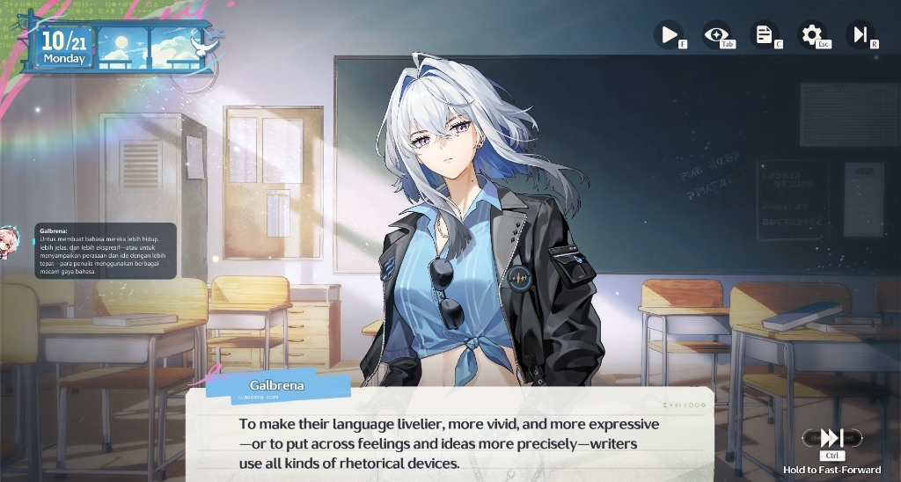
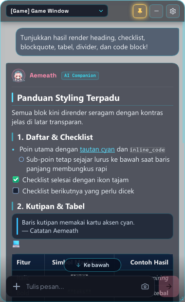
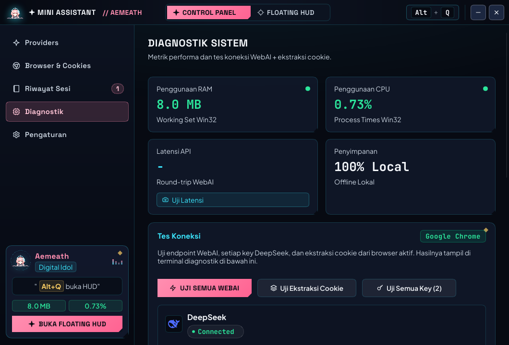
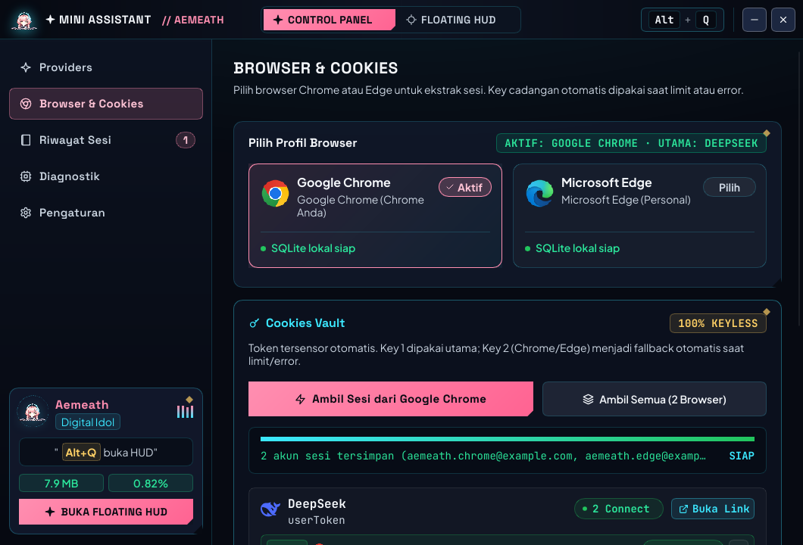
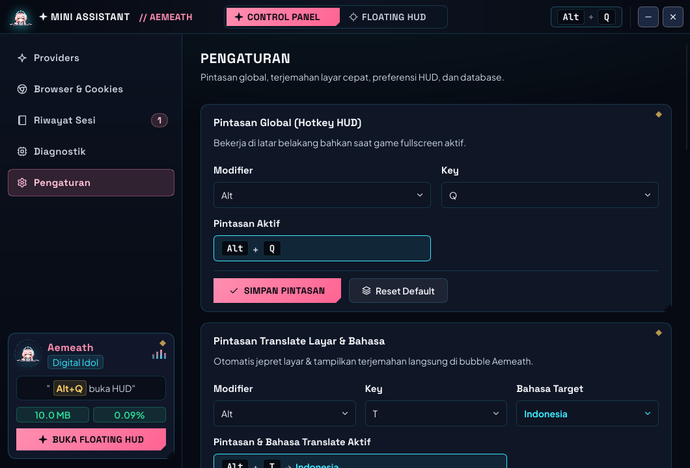

<div align="center">


# ✦ Mini Assistant — Aemeath Edition

**Companion AI desktop native untuk Windows bertema Startorch Academy × Aemeath**  
*Floating HUD kaca Acrylic di atas game · Translate This Screen · Vision · Multi-Browser Vault · Random Singing · 0 WebView · 0 Terminal*

[](https://f4rdani.github.io/Mini-Assistant/)
[](https://github.com/f4rdani/Mini-Assistant/releases/latest)
[](https://github.com/f4rdani/Mini-Assistant/releases/latest)
[](#arsitektur)
[](https://github.com/f4rdani/Mini-Assistant/releases/latest/download/Mini-Assistant-Portable.zip)

[**🌐 Buka Halaman Showcase HTML**](https://f4rdani.github.io/Mini-Assistant/) · [**⬇️ Unduh v1.1.0 Portable**](https://github.com/f4rdani/Mini-Assistant/releases/latest) · [**📊 Benchmark RAM & CPU**](#pantauan-performa-ram--cpu)

</div>

---

## ✨ Cuplikan Antarmuka

<div align="center">
  
  <br />
  <sub><em>Showcase nyata in-game: menekan <code>Alt+T</code> menampilkan terjemahan dialog langsung di bubble maskot Aemeath di tepi layar dengan auto-scroll 60 FPS stop-and-glide.</em></sub>
</div>

<br />

| Floating HUD (DWM Acrylic + Rich Markdown) | Diagnostik Sistem (Live RAM & CPU Monitor) |
| :---: | :---: |
|  |  |

| Browser & Cookies Vault (Chrome & Edge) | Pengaturan, Random Singing & RAM Guard |
| :---: | :---: |
|  |  |

> Lihat galeri lengkap (termasuk **Panel Reasoning + SVG**, **Bubble Screen Translate**, dan widget interaktif **Aemeath Singing Mode**) di halaman showcase [docs/index.html](docs/index.html) atau lewat [GitHub Pages](https://f4rdani.github.io/Mini-Assistant/).

---

## 📊 Pantauan Performa (RAM & CPU)

Tidak ada WebView2, tidak ada Chromium, tidak ada Node.js. Seluruh antarmuka dirender secara native oleh **Slint (software renderer)** dengan server API **Axum** tertanam *in-process* dalam **satu berkas `MiniAssistant.exe`** (`15,67 MB`, arsip ZIP `9,64 MB`, `PE Subsystem = WINDOWS_GUI` — **0 jendela terminal**).

Pengukuran nyata pada paket rilis portable `MiniAssistant.exe` (Windows 12-core, termasuk UI + Embedded API Server dalam 1 proses):

| Mode Operasi | Working Set (Steady) | Private Memory | CPU Idle (Avg / Max) | Catatan |
| :--- | :---: | :---: | :---: | :--- |
| **Bubble Idle** (Minimized Orb) | **3.49 MB** | 13.34 MB | **0.00% / 0.00%** | Otomatis *working-set trim* pada `t = 2 dtk` |
| **Floating HUD** (Acrylic + API) | **4.07 MB** | 14.46 MB | **0.07% / 0.26%** | Siap chat cepat & tangkapan layar di atas game |
| **Control Panel** (Diagnostik Live) | **9.53 MB** | 20.23 MB | **0.09% / 0.26%** | Polling metrik Win32 live tiap 3 detik |
| **Bubble Singing ♪** (WASAPI) | **3.73 MB** | 13.87 MB | **0.29% / 0.64%** | Sprite animasi + not `♪♫` + guard RAM ≥ 85% |

---

## 🚀 Fitur Utama (`v1.1.0`)

- **Floating HUD Overlay & Auto Window Context** — panggil overlay kaca DWM Acrylic secara instan dengan hotkey global (`Shift+Q` / `Alt+Q`). Judul & kategori sesi otomatis mengikuti jendela aktif (`[Game] ...`, `[Dev] ...`).
- **Translate This Screen, Vision & Auto-Scroll 60 FPS (*Stop-and-Glide*)** — tekan `Alt+T` untuk menangkap jendela aktif langsung ke *speech bubble* maskot Aemeath. Teks panjang bergulir perlahan lalu berhenti bertahap pada **60 FPS** sesuai kecepatan baca manusia (`Slow` / `Normal` / `Fast`), otomatis jeda saat *hover*, dan menyerah penuh jika Anda scroll manual.
- **Switch Bahasa In-App Langsung (`ID` / `EN`)** — ubah bahasa seluruh antarmuka (Control Panel, Floating HUD, Bubble, hingga label status) secara *real-time* antara Bahasa Indonesia & English dan langsung tersimpan ke database lokal.
- **Persistensi Cookie Atomik & Auto-Sync Startup** — ekstraksi `userToken` dari LevelDB Chrome & Microsoft Edge secara otomatis saat startup, tersimpan secara atomik dengan cadangan `accounts.json.bak`, memiliki **Priority-First Key Pool**, serta melakukan *auto-refresh* transparan bila sesi kedaluwarsa (`40003` / `401`).
- **Rich Markdown, Reasoning & Web Search** — mendukung chip penalaran (*Berpikir selama N detik*), sitasi pencarian web interaktif, heading, checklist, blockquote, tabel lebar, blok kode siap salin, emoji berwarna Direct2D/COLRv1, dan zoom lightbox SVG/PNG.
- **Random Singing & Guard RAM ≥ 85%** — saat Bubble idle, Aemeath dapat bernyanyi dengan sprite animasi, not musik `♪♫`, dan pipeline audio modern **Media Foundation + WASAPI** — otomatis berhenti dan membebaskan buffer jika RAM sistem ≥ 85%.
- **100% Portable & Single-Instance** — seluruh data (`mini_assistant.db`, `accounts.json`, `.bak`, cache sementara) tersimpan di folder `./data/` lokal yang ikut dipertahankan saat rebuild portable.

### 🗺️ Roadmap
- **Perluasan Provider Modular** — dukungan preset provider tambahan berbasis OpenAI-compatible API.
- **Pintasan Kustom Per-Game Profile** — profil bahasa target translate & kecepatan baca terpisah berdasarkan judul jendela game/aplikasi.

---

## 📦 Unduh & Jalankan (Portable)

1. Unduh **`Mini-Assistant-Portable.zip`** (`9.64 MB`) dari [GitHub Releases](https://github.com/f4rdani/Mini-Assistant/releases/latest).
2. Ekstrak ke folder mana saja (tidak perlu installer dan tidak memerlukan skrip `.bat`).
3. Klik ganda **`MiniAssistant.exe`** — Floating HUD, server API lokal, dan auto-sync sesi langsung aktif tanpa jendela terminal.
4. Pastikan sudah login di Chrome atau Microsoft Edge (atau buka **Pengaturan → Browser & Cookies** untuk kelola multi-akun).

---

## 🏗️ Arsitektur

Proyek ini mendukung **dua mode build** dari satu basis kode Rust:

```text
[Consumer Release Portable — 1 File]
MiniAssistant.exe (15.67 MB) = ui-native (Slint) + app-core + backend-api-ai (embedded in-process)
  ├── assets/   (42 file sprite Aemeath, logo & musik — 1.68 MB)
  └── data/     (mini_assistant.db, accounts.json (.bak), cache — 100% portable)

[Development Mode — 3 Crate Modular Terpisah]
ui-native/          binary  Slint UI (Control Panel, Floating HUD, Bubble) + Win32/WASAPI
   │  in-process Rust library call (0 IPC)
   ▼
app-core/           lib     LevelDB/Cookie extractor, SQLite, Win32 capture, hotkey, metrics
   │  HTTP 127.0.0.1:8787 (OpenAI-compatible)
   ▼
backend-api-ai/     binary  Standalone API server (PoW, SSE, vision, file upload, priority pool)
```

---

## 🛠️ Build dari Source (Developer)

Prasyarat: **Windows 10/11** dengan toolchain **Rust** (`cargo`) dan Windows SDK.

### 1. Build Paket Portable Release (Otomatis)
```powershell
git clone https://github.com/f4rdani/Mini-Assistant.git
cd Mini-Assistant
powershell -ExecutionPolicy Bypass -File .\scripts\build-portable.ps1
```
Hasil paket bersih siap distribusi terbentuk di `dist\Mini-Assistant-Portable\` dan `dist\Mini-Assistant-Portable.zip`.

### 2. Menjalankan Mode Development (Modular / Terpisah)
```powershell
# Terminal 1 — Provider API mandiri (release disarankan agar PoW cepat)
cargo run --release --manifest-path backend-api-ai/Cargo.toml

# Terminal 2 — Native Slint UI (modular, log diagnostik aktif)
cargo run --manifest-path ui-native/Cargo.toml
```

### 3. Menjalankan Pengujian Otomatis
```powershell
cargo test --manifest-path backend-api-ai/Cargo.toml
cargo test --manifest-path app-core/Cargo.toml
cargo test --manifest-path ui-native/Cargo.toml
```

### Environment Variables (Opsional)

| Variabel | Default | Fungsi |
| :--- | :--- | :--- |
| `MINI_API_URL` | `http://127.0.0.1:8787` | Lokasi provider API (mode modular/eksternal) |
| `MINI_API_KEY` | kosong | API key opsional jika server memakai `API_KEYS` |
| `MINI_ADMIN_KEY` | kosong | Admin key opsional untuk endpoint `/admin/*` |
| `MINI_DATA_DIR` | `./data` (portable) / `%APPDATA%\MiniAssistant` (dev) | Override direktori database & akun |

---

## 🌐 Publikasi Showcase via GitHub Pages

Halaman showcase bertema Aemeath sudah tersedia self-contained di folder [`docs/`](docs/):
1. Push repository ini ke `https://github.com/f4rdani/Mini-Assistant`.
2. Buka **Settings → Pages** di GitHub.
3. Pada **Build and deployment → Source**, pilih **Deploy from a branch** → Branch `main` → Folder **`/docs`** → **Save**.
4. Halaman showcase langsung aktif di `https://f4rdani.github.io/Mini-Assistant/`.

---

## 📁 Struktur Repository

| Path | Isi |
| :--- | :--- |
| `docs/` | Halaman HTML showcase GitHub Pages (`index.html` + `assets/`) |
| `ui-native/` | Native Slint UI, tema Startorch × Aemeath (`theme.slint`), Win32 acrylic/capture/WASAPI |
| `app-core/` | Core library: LevelDB/Cookie extractor, SQLite storage, global hotkey, live metrics |
| `backend-api-ai/` | Provider API OpenAI-compatible (bisa standalone atau embedded *in-process*) |
| `scripts/` | `build-portable.ps1` untuk membungkus paket portable release |
| `PRD.md` | Dokumen spesifikasi produk |
